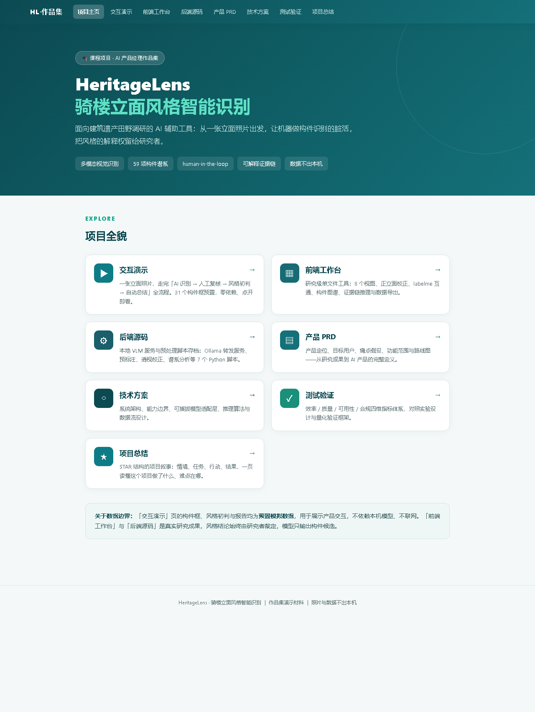

# HeritageLens · 骑楼立面风格智能识别

> 一个面向建筑遗产田野调研的 **AI 辅助工具 / AI 产品经理课程作品集**。
>
> 核心思路：让机器做构件识别的「脏活」，把风格的解释权留给研究者。

在线预览：**https://zhangwenxuan687-beep.github.io/Heritage-Lens/**



---

## 这个项目解决什么问题

台山老墟的骑楼藏着百年南洋侨乡的建筑密码，但研究它们是个笨功夫：一次田野调研几百张照片，筛选慢、构件漏标难发现、人工复核成本高、照片与文献证据难追溯。通用多模态模型又缺乏专业构件语义、输出不可复现、数据还要出域。

HeritageLens 把这条链路重新组织成一套**「机器出草稿 + 人工终审 + 领域知识约束」**的工作流：

```
田野照片 → EXIF 转正 → 四点透视校正 → VLM 构件草稿框 → 人工逐框复核
        → 加权证据推理 → 风格谱系导出
```

全程本地运行，**照片不出本机**。模型的职责止于「识别构件」；风格判断始终由研究者依据证据裁定——这是这个项目刻意守住的方法论边界。

---

## 作品集导航

站点由一张门户页串起全部内容，打开主页即可逐页进入：

| 页面 | 内容 |
|---|---|
| [🏠 项目门户](https://zhangwenxuan687-beep.github.io/Heritage-Lens/) | 项目全貌与导航 |
| [▶️ 交互演示](https://zhangwenxuan687-beep.github.io/Heritage-Lens/demo.html) | 一张立面照片，走完「AI 识别 → 人工复核 → 风格初判 → 自动总结」全流程 |
| [▦️ 前端工作台](https://zhangwenxuan687-beep.github.io/Heritage-Lens/workbench.html) | 研究级单文件工具：8 个视图、正立面校正、labelme 互通、构件图谱、证据链推理与数据导出 |
| [⚙️ 后端源码](https://zhangwenxuan687-beep.github.io/Heritage-Lens/backend.html) | 7 个 Python 脚本源码存档：Ollama 转发、VLM 预标注、批量校正、谱系分析等 |
| [📋 产品 PRD](https://zhangwenxuan687-beep.github.io/Heritage-Lens/prd.html) | 产品定位、目标用户、痛点假设、功能范围与路线图 |
| [◇️ 技术方案](https://zhangwenxuan687-beep.github.io/Heritage-Lens/architecture.html) | 系统架构、能力边界、可插拔模型适配层、推理算法与数据流 |
| [✅ 测试验证](https://zhangwenxuan687-beep.github.io/Heritage-Lens/testing.html) | 效率 / 质量 / 可用性 / 合规四维指标体系与对照实验设计 |
| [★ 项目总结](https://zhangwenxuan687-beep.github.io/Heritage-Lens/star.html) | STAR 结构的项目叙事，一页读懂项目做了什么、难点在哪 |

---

## 核心能力

- **8 视图研究工作台**：单文件 HTML，涵盖研究总览、风格谱系、构件图谱、正立面校正、识别工作台、样本库与导出等。
- **59 项构件谱系**：47 项主词表（含权重）+ 12 项扩充项，52 条别名映射统一跨人判读口径。
- **VLM 构件预标注**：本地 Qwen3-VL 4B 出草稿框，四层容错解析，人工逐框复核后才计入证据。
- **可解释证据链**：加权证据推理给出候选风格提示，逐条构件可溯源到正立面位置与文献出处。
- **数据互通与导出**：labelme JSON 双向互通，构件 0/1 矩阵、谱系、CSV / JSON 数据集导出。
- **可插拔模型适配层**：统一推理契约，替换模型不改界面与业务逻辑。

---

## 技术栈

| 层 | 技术 |
|---|---|
| 前端 | 原生 HTML / CSS / JavaScript（单文件工作台，零构建、双击即用） |
| 视觉模型 | Ollama + Qwen3-VL 4B（本机 CPU 推理） |
| 后端 / 预处理 | Python（VLM 转发服务、预标注、四点透视校正、谱系分析） |
| 标注工具 | labelme（构件预标注与 JSON 互通） |
| 数据分析 | 汉明距离 + NJ 邻接归并谱系树、构件 0/1 矩阵 |
| 存储与导出 | 浏览器 localStorage、JSON / CSV |
| 部署 | GitHub Pages（静态托管） |

---

## 仓库结构

```
.
├── index.html              作品集门户（主页）
├── demo.html               HR 交互演示页（预置模拟数据）
├── workbench.html          研究工作台前端（8 视图单文件工具）
├── backend.html            后端源码存档页
├── prd.html / architecture.html / testing.html / star.html
│                           产品 PRD / 技术方案 / 测试验证 / 项目总结
├── assets/
│   └── preview.png         门户预览图
└── src/backend/            7 个 Python 后端与预处理脚本（源码存档）
```

---

## 本地运行

### 前端 / 演示（零依赖）

直接双击 `index.html`、`demo.html` 或 `workbench.html` 用浏览器打开即可，无需构建、无需联网。
`demo.html` 全部数据为预置模拟，点开即看，不依赖任何模型服务。

> 提示：`index.html` 与 `demo.html` 中的 `file://` 直开版本如需调用真实视觉模型，需配合下面的本地转发服务。

### 后端（可选，本机运行）

GitHub Pages 是静态托管，**不运行后端**。源码在 `src/backend/` 供查看与下载，设计上全部在本机运行：

```bash
cd src/backend
python start_vlm_workbench.py        # 启动 VLM 转发服务（127.0.0.1:8765 → Ollama 11434）
```

- **转发服务 / 预标注 / 索引 / 谱系脚本**：纯 Python 标准库，无需额外安装。
- **`batch_rectify.py`（批量透视校正）**：需 `opencv-python-headless` + `numpy`，脚本顶部已写明安装命令（建议装到 D 盘独立目录，避免占用 C 盘）。
- 前提：本机已安装并运行 Ollama，且已拉取 `qwen3-vl:4b` 模型。转发服务为 `file://` 页面补上 CORS 头，使前端能安全调用本地模型。照片与标注全程留在本机，不上传任何外部服务。

---

## 数据与方法边界

本项目对「真实成果」与「规划 / 演示」作了严格区分：

- **交互演示页**的构件框、风格初判与文字报告均为**预置模拟数据**，用于展示产品交互，不代表模型真实输出，不构成任何研究结论。
- **产品 / 测试文档**中的「目标值 / 待实测 / 规划」指标均为规划，非已达成成果；已实测数据才单独标注。
- **风格判定**的方法论口径：模型只输出构件候选与证据，风格由研究者解释性归并、人工裁定。工作台上原有的研究红线口径未被改动。
- **数据合规**：所有本地脚本不向外部服务上传田野照片。

---

## 作者

**zhangwenxuan687-beep** · AI 产品经理方向课程作品集 · 2026.09 – 2026.11

项目为个人在课程中各阶段产出与作品集整理的成果，技术细节与个人贡献边界见 `star.html` 与各文档页说明。

如需交流，请通过 GitHub 主页联系。
